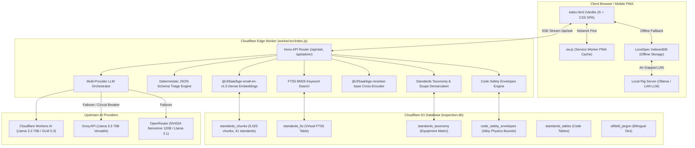

# SpecSupport / Inspecta — Master Technical Specification & Architecture Context

**System Version:** 2.6.0-Enterprise  
**Target Environment:** Cloudflare Edge Workers + Cloudflare D1 Database + PWA Offline Rig Engine  
**Live API Endpoint:** `https://inspection-api.mohamedtarekhse.workers.dev`  
**Live Web Application:** `https://final.specsupport.pages.dev`  
**Primary Repository:** `mohamedtarekhse/SpecSupport` (Branch: `final`)  

---

## 1. Executive Summary & Purpose

**SpecSupport (Inspecta)** is an enterprise-grade, domain-specialized AI Decision Support System and Progressive Web Application (PWA) tailored specifically for Quality Assurance (QA), Quality Control (QC), Non-Destructive Examination (NDE/NDT), and Welding Engineers operating in the Oil & Gas, Petrochemical, Offshore, and Pipeline industries.

The platform provides:
1. **Audit-Grade Verification:** Authoritative engineering determinations grounded in verified international standards (API, ASME, AWS, ISO, NACE, IADC, DS-1).
2. **Dual-Pass Loop Engineering:** An automated *Draft Model $\rightarrow$ Level III Critic Agent* pipeline governed by physical code safety envelopes (preheat, interpass, PWHT soak temperatures, hardness thresholds, and rejection limits).
3. **LocaSpec™ Field Offline Rig Engine:** Complete zero-connectivity rig operation via a PWA service worker, browser IndexedDB vector storage, and an optional local rig AI server bridge (Docker/Ollama on local LAN).
4. **Interactive Progressive Elicitation:** Deterministic, strongly-typed JSON Schema multiple-choice questions (MCQs) that guide inspectors through missing critical parameters (materials, schedules, test pressures, service severities) before delivering a binding verdict.

---

## 2. High-Level Architecture Diagram



---

## 3. Core AI Engineering Innovations (How the System Works)

### A. The Universal API Rosetta Genome (The 4 Pillars)
Every query evaluated by the platform is structured through four universal pillars inherent to engineering standards:
1. **Pillar 1: Scope Guard & Equipment Demarcation:**
   * Explicitly defines in-scope vs. out-of-scope equipment.
   * Prevents standard cross-contamination (e.g., using API 1104 pipeline rules on ASME B31.3 plant piping, or citing API 16AR drill-through remanufacture rules for new API 16C choke manifold manufacturing).
2. **Pillar 2: Direct Verdict & Discard / Rejection Limits:**
   * Eliminates conversational preamble.
   * Delivers immediate numerical limits (maximum allowable wear %, minimum remaining wall thickness $t_{\text{min}}$, maximum allowable pit depth, zero-crack tolerance).
3. **Pillar 3: Normative Reference Bridge (NDT & Welding Chain):**
   * Connects high-level Recommended Practices (e.g., API RP 8B or API 510) to procedural codes: ASME Section V (NDT methods), ASME Section IX / AWS D1.1 (welding qualifications), and ASNT SNT-TC-1A / ISO 9712 (personnel certification).
4. **Pillar 4: QA/QC Documentation & Rig Audit Matrix:**
   * Details mandatory quality records required during rig audits: Mill Test Reports (MTR to EN 10204 Type 3.1/3.2), Certificates of Conformance (COC), NDT inspection reports, Inspection & Test Plan (ITP) Hold Points ($H$), Witness Points ($W$), and Surveillance ($S$).

---

### B. Dual-Pass Loop Engineering (Draft $\rightarrow$ Level III Critic)
Instead of relying on single-shot LLM generation, SpecSupport runs a closed-loop dual-pass verification pipeline:
* **Pass 1 (Draft Model):**
  * Synthesizes retrieved chunks from D1 using BM25 and dense vector embeddings into an initial technical response.
* **Pass 2 (Level III Engineering Critic Agent):**
  * Queries `code_safety_envelopes` from D1 (containing exact metallurgical preheats, interpass temperatures, PWHT soak ranges, and hardness boundaries for P-Numbers 1 through 15E).
  * Validates the Pass 1 draft against these hard envelopes.
  * Corrects any hallucinated clauses, missing safety buffers, or non-compliant preheat parameters.
  * Streams the critique-refined verdict directly to the user's browser over Server-Sent Events (SSE).

---

### C. 3-Tier Hybrid Search & Re-Ranking
To guarantee near-zero retrieval hallucination across 9,025 chunks:
1. **Tier 1 — Full-Text Search (FTS5 BM25):** Executes lexical keyword matching against `standards_fts` to find verbatim clause numbers, table designations, and acronyms.
2. **Tier 2 — Dense Vector Embedding:** Generates a 384-dimensional dense vector for the user inquiry via Cloudflare Workers AI (`@cf/baai/bge-small-en-v1.5`) and calculates cosine similarity against stored chunk embeddings.
3. **Tier 3 — Cross-Encoder Re-Ranker:** Feeds the top 10 candidate clauses into `@cf/baai/bge-reranker-base`. The cross-attention model scores query-passage relevance with high precision, placing exact governing clauses at the top rank before prompt synthesis.

---

### D. Strongly-Typed Interactive Triage Engine
When an inspector submits an ambiguous query (e.g., *"give me a welding procedure"* without stating material or pipe thickness):
* The worker's `getDeterministicTriageMcqs()` function intercepts the query.
* It classifies the discipline: Welding (ASME IX / B31.3), NDT (ASME V / ISO 9712), Hydrotest (B31.3 / B31.4 / B31.8), Integrity / FFS (API 510 / 570 / 579), Hoisting (API RP 8B / 4G), Tubulars (API RP 7G-2 / DS-1), or Well Control (API 53).
* Emits a strict JSON array of interactive chip questions (`mcq_questions`) in the SSE `complete` payload.
* The frontend renders interactive triage chips allowing the user to select parameters (e.g., ASTM A106 Gr B, Sch 80, Sour Service) with a single click, instantly refining the answer.

---

### E. LocaSpec™ Field Offline Rig Engine
For offshore drilling rigs, desert workover sites, and turnaround vessels with zero internet connectivity:
* **Service Worker (`sw.js`):** Caches the application shell, fonts, icons, and UI logic for full offline boot.
* **IndexedDB Database (`LocaSpecDB`):** Stores encrypted or synchronized standard clause bundles (up to 6,000+ chunks) directly in browser storage.
* **Offline Search Engine (`LocaSpecEngine`):** Executes client-side semantic matching, token scoring, and regex clause extraction directly in browser memory.
* **Local Rig AI Server Bridge:** Integrates seamlessly with an on-rig local LLM (running via Ollama or Docker on the local rig network at `http://192.168.x.x:11434`), streaming fully private, air-gapped inferences without touching external cloud infrastructure.

---

## 4. Comprehensive File-by-File Breakdown

### Root Directory

| File | Purpose & Operational Logic |
| :--- | :--- |
| `index.html` | Master Single Page Application (SPA). Contains ~10,500 lines of HTML, CSS, and Vanilla JavaScript. Implements chat UI, NotebookLM-style dynamic standards sidebar, LocaSpec offline management modal, interactive parameter boxes, ASME Form QW-482 WPS generator, PDF/Word export tools, voice transcription, and KaTeX math rendering. |
| `sw.js` | Service Worker implementing a Network-First strategy with Cache Fallback for static assets. Includes explicit protocol guards to ignore `chrome-extension://` requests, eliminating browser cache exceptions. |
| `manifest.json` | Web App Manifest defining standalone PWA properties, theme colors, icons (192px and 512px), and installation prompts for Android, iOS, and Chromium desktop. |
| `package.json` | Project root manifest containing helper scripts and dev dependencies. |
| `schema.sql` | Base SQLite / D1 database schema defining `standards_chunks`, `standards_fts`, and core metadata structures. |
| `migrate.sql` | D1 database schema migration definitions for updating columns, indexes, and tables. |
| `icon-192.png`, `icon-512.png` | Standard PWA application icons displayed on mobile home screens and desktop taskbars. |
| `refiner.html` | Standalone UI utility for reviewing, testing, and refining standard clauses. |
| `FULL_CONVERSATION_HISTORY.md` | Persistent markdown log of development interactions and architectural decisions. |

---

### Worker Subsystem (`worker/`)

| File | Purpose & Operational Logic |
| :--- | :--- |
| `worker/src/index.js` | The central backend application (~6,100 lines) built on the Hono framework running on Cloudflare Workers Edge. Coordinates multi-provider LLM failover, hybrid RAG retrieval, cross-encoder re-ranking, code safety envelopes, standards taxonomy routing, D1 memory bounds, and SSE streaming. |
| `worker/wrangler.toml` | Cloudflare Workers configuration file binding the worker to Cloudflare D1 (`inspection-db`), Cloudflare Workers AI (`AI`), environment variables, and public routing triggers. |
| `worker/package.json` | Backend dependencies including Hono, Zod, and Cloudflare Workers type definitions. |
| `worker/schema_update.sql` | Incremental database patch for adding taxonomy and relationship tables to D1. |

---

### Scripts Subsystem (`scripts/`)

#### 1. Verification, Testing & CI/CD
| Script | Description |
| :--- | :--- |
| `scripts/ci_cd_loop3_deploy.js` | Automated CI/CD deployment pipeline. Executes 14 Golden Evaluation tests and 60 retrieval scenarios; strictly blocks production deployment if score drops below 100%. |
| `scripts/full_test_deployed_developments.js` | Comprehensive 31-point test suite verifying cross-encoder re-ranking, JSON schema triage across all 7 engineering disciplines, negative controls, and non-streaming parity. |
| `scripts/run_golden_evals.js` | Runs 14 core golden evaluation benchmarks verifying physical and metallurgical accuracy. |
| `scripts/evaluate_60_retrieval_questions.js` | Evaluates 60 complex oilfield queries across all 41 standards to audit precision and recall. |
| `scripts/scheduled_final_gate.js` | Standalone verification gate executing comprehensive health checks before release. |
| `scripts/audit_system_accuracy.js` | System accuracy audit script checking answer consistency and standard citations. |

#### 2. Ingestion & Standards Extraction
| Script | Description |
| :--- | :--- |
| `scripts/ingest.js` | Base ingestion script reading standard text files and loading chunked records into D1. |
| `scripts/ingest_asme_ix_qw422_materials.js` | Ingestion script parsing ASME Section IX Table QW/QB-422 material base metals (P-Numbers, Group Numbers, tensile strengths). |
| `scripts/ingest_enriched_aws_nace_chunks.js` | Ingestion script importing enhanced chunks for AWS D1.1 visual criteria and NACE MR0175 sour service limits. |
| `scripts/ingest_well_control_and_oem.js` | Ingestion script importing API Standard 53, IADC Well Control Manual, and OEM BOP maintenance procedures. |
| `scripts/ingest_iadc_manual.py` | Python script processing the IADC Drilling Manual and chunking well control procedures into D1. |
| `scripts/pdf_processor.py` | Extracts text, tables, and section hierarchies from raw standard PDF documents. |
| `scripts/standards_forge.py` | Python pipeline converting unstructured standards text into structured Rosetta Genome chunks. |

#### 3. Embeddings & Database Optimization
| Script | Description |
| :--- | :--- |
| `scripts/backfill_all_embeddings.js` | Iterates over all chunks in `standards_chunks` with `NULL` embeddings, generates 384-dimensional vectors via `@cf/baai/bge-small-en-v1.5`, and commits them to D1. |
| `scripts/audit_embeddings_and_rag.js` | Audits vector completeness, embedding dimensions, and identifies orphan chunks. |
| `scripts/defrag_standard_codes.js` | Normalizes standard code strings (e.g., standardizing `API 6 A` to `API 6A`) to ensure clean SQL joins. |
| `scripts/refine_entire_d1.js` | Data-cleaning script removing web boilerplate, copyright disclaimers, and redundant headers from D1 chunks. |
| `scripts/expand_safety_envelopes.sql` | SQL migration script populating `code_safety_envelopes` with alloy envelopes for P-8, P-15E, API 5L, and Inconel alloys. |

#### 4. Architecture & UI Enhancement
| Script | Description |
| :--- | :--- |
| `scripts/apply_buffer_chamber_taxonomy.js` | Injects the governing taxonomy entry for Choke Manifolds & Buffer Chambers (API 16C / ASME VIII) and establishes the strict API 16AR prohibition rule. |
| `scripts/add_locaspec_engine.js` | Integrates the LocaSpec offline synchronization routines into `index.html`. |
| `scripts/add_wps_form_qw482_ui.js` | Injects the ASME Form QW-482 Welding Procedure Specification modal and interactive generator into the frontend. |
| `scripts/export_conversation_to_md.js` | Exports complete conversation histories into structured markdown reports. |

---

### LocaSpec Subsystem (`LocaSpec/`)

| File | Purpose & Operational Logic |
| :--- | :--- |
| `LocaSpec/app.py` | Standalone Python Flask server enabling local deployment of the LocaSpec engine on a rig workstation or local network. |
| `LocaSpec/static/index.html` | Fully self-contained offline distribution of the SpecSupport frontend interface. |
| `LocaSpec/requirements.txt` | Python dependencies for running the local LocaSpec workstation server. |
| `LocaSpec/run.bat` | One-click Windows batch launcher for initiating the local workstation server. |

---

### Rig-Server Subsystem (`rig-server/`)

| File | Purpose & Operational Logic |
| :--- | :--- |
| `rig-server/docker-compose.yml` | Production Docker Compose configuration deploying an air-gapped rig setup: combines an Ollama local LLM service with an Nginx reverse proxy. |
| `rig-server/README.md` | Deployment guide for field IT and rig electricians configuring air-gapped local LAN AI nodes. |
| `rig-server/run-locaspec-server.bat` | Windows batch launcher for initializing the local Docker rig server. |
| `rig-server/run-locaspec-server.sh` | Linux / macOS shell launcher for initializing the local Docker rig server. |

---

### Documentation Subsystem (`docs/`)

| File | Description |
| :--- | :--- |
| `docs/ARCHITECTURE_AND_FILES.md` | Architectural reference outlining subsystem interactions and code responsibilities. |
| `docs/HOW_AI_COMPREHENDS_STANDARDS.md` | Deep dive into semantic chunking, Rosetta Genome structures, and vector search mechanics. |
| `docs/ROSSETA.txt` | Prompt design guide and foundational specification for the Universal API Genome. |
| `docs/AUDIENCE_PRESENTATION.md` | Strategic overview and presentation deck detailing platform capabilities for enterprise energy clients. |

---

### Standards Subsystem (`standards/`)

Contains the 41 primary standard text files ingested into Cloudflare D1, including:
* **Welding & Fabrication:** `ASME_IX_WPS_PQR.txt`, `AWS_D1.1_Visual_Acceptance.txt`, `API_1104_Pipeline_Welding.txt`, `ISO_3834-2_Welding_Quality.txt`.
* **NDE / NDT Examination:** `ASME_V_Article2_RT.txt`, `ASME_V_Article4_UT.txt`, `ASME_V_Article6_PT.txt`, `ASME_V_Article7_MT.txt`, `ASME_V_Article9_VT.txt`, `AWS_B1.11_Visual_Examination.txt`, `API_RP_2X_Offshore_UT.txt`, `ASNT_SNT_TC_1A_NDT_Personnel.txt`.
* **Pressure Equipment & Piping:** `ASME_B31.3_Weld_Acceptance.txt`, `ASME_B31.4_Liquid_Pipeline.txt`, `ASME_B31.8_Gas_Pipeline.txt`, `ASME_VIII_Div1_Welded_Vessels.txt`, `API_510_Vessel_Inspection.txt`, `API_570_Piping_Inspection.txt`.
* **Well Control & Drilling Equipment:** `API 53.txt`, `IADC_Well_Control_Manual.txt`, `API_16D_16AR_BOP_Systems.txt`, `OEM_BOP_Operations_and_Repair.txt`.
* **Hoisting & Tubulars:** `API_RP_8B_Hoisting_Equipment.txt`, `API_4F_4G_Drilling_Structures.txt`, `API_RP_7G-2_Drill_Stem_Inspection.txt`, `API_5CT_Casing_Tubing.txt`, `API_RP_5C1_Casing_Care.txt`, `API_RP_7K_Drilling_Equipment.txt`.
* **Materials & Metallurgy:** `NACE_MR0175_Sour_Service.txt`.

---

## 5. D1 Database Schema Architecture

The Cloudflare D1 database (`inspection-db`, ID: `5e8696db-10ab-4eaf-92b0-de5f21a007f6`) maintains 8 primary tables:

### 1. `standards_chunks`
Stores all modularized standard clauses.
* `id` (INTEGER PRIMARY KEY): Unique chunk identifier.
* `standard_code` (TEXT): Standard identifier (e.g., `ASME B31.3`, `API 16C`, `API RP 8B`).
* `standard_name` (TEXT): Full formal title of the governing code.
* `section` (TEXT): Chapter or section heading.
* `clause` (TEXT): Specific numerical clause (e.g., `Table 341.3.2`, `Clause 9.3.4`).
* `content` (TEXT): Verbatim technical text requirement.
* `embedding` (TEXT): Serialized 384-dimensional JSON array generated by `@cf/baai/bge-small-en-v1.5`.
* `scope` (TEXT): Global or temporary sandbox scope (`global`, `private_temp`).
* `organization` (TEXT): Standard body (`API`, `ASME`, `AWS`, `ISO`, `NACE`, `IADC`).
* `pillar_type` (TEXT): Assigned Rosetta Genome pillar (`SCOPE_DEMARCATION`, `DISCARD_LIMITS`, `NORMATIVE_REFS`, `QA_AUDIT_DOCS`).
* `acceptance_limits` / `rejection_limits` (TEXT): Explicit numerical thresholds extracted from text.
* `is_excluded` (INTEGER): Soft-delete flag (0 = Active, 1 = Excluded).

### 2. `standards_fts`
SQLite FTS5 virtual table indexing `rowid`, `standard_code`, `section`, `clause`, and `content` for sub-millisecond BM25 ranking.

### 3. `standards_taxonomy`
Equipment-to-Standard governance matrix preventing cross-code hallucinations.
* Columns: `equipment_category`, `equipment_name`, `keywords`, `primary_standard`, `companion_standards`, `prohibited_standards`, `governing_clause_table`, `default_service_condition`, `primary_ndt_method`, `sop_personnel_qualification`, `mandatory_hold_point`, `inspection_frequencies`.

### 4. `code_safety_envelopes`
Hard metallurgical physics boundaries queried by the Level III Critic Agent.
* Columns: `material_group` (P-Numbers 1 to 15E, API 5L, Inconel), `nominal_composition`, `min_preheat_c`, `max_interpass_c`, `pwht_required_thickness_mm`, `pwht_temp_min_c`, `pwht_temp_max_c`, `max_hardness_hrc`, `primary_code`, `notes`.

### 5. `standards_tables`
Structured tabular code data (e.g., weld acceptance criteria tables, NDT qualification matrices).

### 6. `oilfield_jargon`
Bilingual dictionary translating colloquial field terms (e.g., *"سوستة"* $\rightarrow$ *Root Concavity / Incomplete Penetration* per API 1104 / ASME B31.3).

### 7. `system_config`
Dynamic runtime configuration storing active AI provider priorities, model selections, and API key overrides.

### 8. `usage_log` & `user_subscriptions`
Session tracking, rate-limiting, and enterprise license key verification records.

---

## 6. Critical Engineering Protections & Guardrails

| Guardrail | Problem Solved | Implementation Mechanism |
| :--- | :--- | :--- |
| **D1 50 MB Payload Protection** | Cloudflare D1 terminates queries exceeding 50 MB in result size. | Unconditionally enforces `LIMIT 80` on RAG queries; paginates LocaSpec exports in 1,000-row chunks. |
| **SQLite 100-Variable Guard** | SQLite throws `too many SQL variables at offset ...` if host parameters (`?`) exceed 100. | Validates and inlines integer FTS IDs directly into `id IN (...)` (consuming 0 variables); caps standard filter parameters to $\le 30$. |
| **Service Worker Extension Guard** | Chrome extension requests (`chrome-extension://`) crash `cache.put()`. | Validates protocol in `sw.js`: returns immediately if request is not `http://` or `https://`. |
| **Multi-Provider Failover** | Third-party AI rate-limiting (HTTP 429) or model decommissioning. | Circuit-breaker cascade: Cloudflare Workers AI $\rightarrow$ Groq Llama 3.3 70B $\rightarrow$ OpenRouter NVIDIA Nemotron. |
| **Scope Demarcation Alert** | LLMs confusing similar equipment scopes (e.g., API 16AR vs API 16C). | Injects mandatory taxonomy rules into system prompts forbidding out-of-scope standards before drafting begins. |

---

## 7. Development & Deployment Procedures

### Production Deployment Command
All deployments must be executed from inside the `worker/` directory:
```powershell
cd "c:\Users\MT\Desktop\inspect support\worker"
npx.cmd wrangler deploy
```

### Full Automated Verification Suite
To verify system integrity prior to any release:
```powershell
node scripts/full_test_deployed_developments.js
```
*Evaluates: Doctor health, Static vs Cyclic weld discrimination, P-15E alloy preheats, all 7 Triage Disciplines, negative controls, and JSON parity.*
